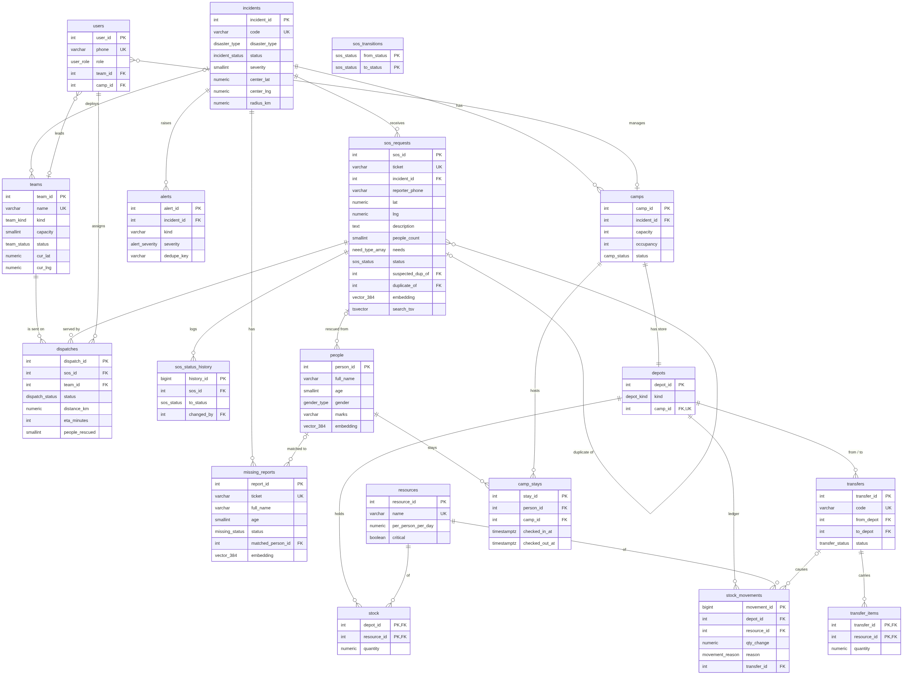
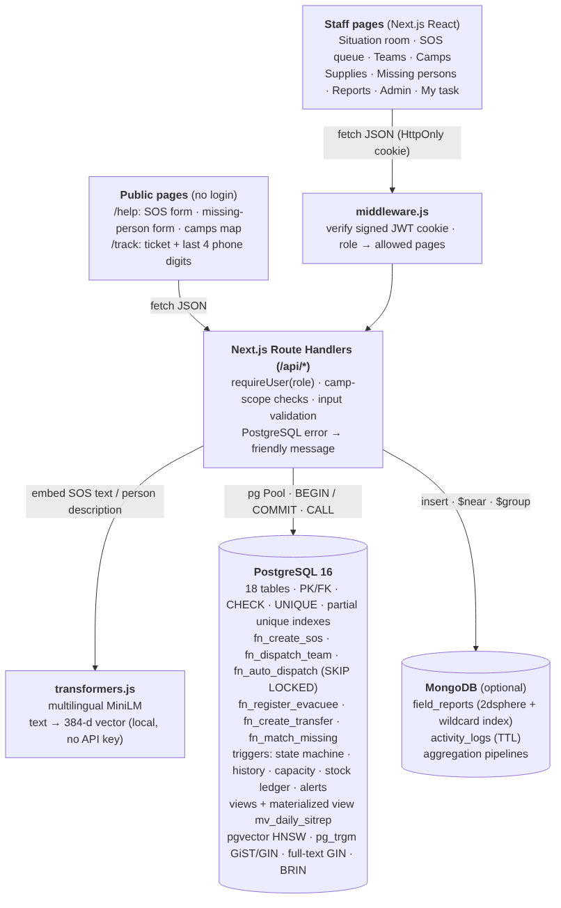

# RAHAT: Disaster Relief Coordination System

**DBMS Experiential Learning, Level 3 Project**

| | |
|---|---|
| **Team** | _Member 1 name, SRN_ · _Member 2 name, SRN_ |
| **Section** | _Section_ |
| **Repository** | _https://github.com/&lt;user&gt;/rahat_ |
| **Database option** | Option 2: SQL (PostgreSQL 16) + vector database (pgvector). MongoDB is used in addition for flexible field reports. |

---

## 1. Objectives

During a disaster, the district control room receives hundreds of calls and messages in several languages. It has a few dozen rescue teams and a handful of relief camps. Today this is coordinated on paper, WhatsApp groups and spreadsheets. That leads to five recurring failures:

1. **The wrong request is served first.** A family with an injured grandmother waits while a later, less urgent call gets the boat.
2. **Double work.** The same family calls three times from three phones, and three teams go to one roof. Or two coordinators send the same team to two places.
3. **Overflowing camps.** Evacuees are sent to a camp that is already full, and nobody notices that the water will run out tomorrow.
4. **Lost supplies.** Nobody can say how much rice is where, or which truck never arrived.
5. **Missing people.** A family searches for a relative who is already registered, under a slightly different spelling, in another camp.

**RAHAT's objective** is to make the database the single source of truth for the response and to have it enforce the rules that prevent these failures:

- Rank SOS requests with a transparent priority score that also rises with waiting time.
- Detect duplicate SOS automatically: same phone, same spot, or the same meaning in another language.
- Assign the nearest suitable free team atomically, so a team can never be on two jobs.
- Enforce camp capacity under concurrent check-ins and warn before critical supplies run out.
- Keep an append-only stock ledger with transfers between depots.
- Match missing-person reports against everyone registered in camps, by name *and* description.

## 2. Functional requirements

| # | Requirement | Who |
|---|---|---|
| F1 | Report an emergency without an account (needs, people, injured/children/elderly, location on a map, description in any language) and receive a ticket | Citizen |
| F2 | Track a ticket with the last 4 digits of the phone | Citizen |
| F3 | Report a missing person; be told if a likely match already exists | Citizen |
| F4 | See the triage queue ranked by priority; search requests by ticket, phone, words or meaning | Coordinator |
| F5 | Review automatically flagged duplicates and merge or dismiss them | Coordinator |
| F6 | See the nearest free teams that can handle a request and dispatch one; auto-dispatch the top requests | Coordinator |
| F7 | Update a job: en route → on scene → completed (people rescued) or aborted (reason) | Responder, Coordinator |
| F8 | Open camps; register arrivals; check people out; refuse check-ins when full | Coordinator, Camp manager |
| F9 | Record donations, send trucks between depots, receive or cancel them, distribute supplies | Coordinator, Camp manager |
| F10 | Days-of-supply per camp, with automatic low-supply, camp-full and overdue-SOS alerts | System |
| F11 | Ranked candidates for each missing-person report; confirm a match; mark reunited | Coordinator |
| F12 | Daily situation report, response-time percentiles, hotspots, team performance | Coordinator |
| F13 | Manage incidents, user accounts and teams | Admin |
| F14 | Field situation reports (water levels, blocked roads, damage) with type-specific fields | Coordinator, Responder |

**Roles (4 + public):** admin, coordinator, responder, camp_manager, plus anonymous citizens on `/help`.

## 3. ER diagram



**Main relationships**

- An **incident** has many SOS requests, camps, missing reports and alerts.
- An **SOS request** may be a duplicate of another SOS (a self-referencing FK). It has many **dispatches** and many **status history** rows.
- A **team** has many dispatches over time but **at most one live dispatch**. This is a partial unique index.
- A **camp** has exactly one **depot** (its store), created by a trigger. Warehouses are depots without a camp.
- **Stock** is the M:N between depots and resources (composite PK). **Stock movements** are the ledger behind it.
- A **transfer** carries many items (M:N transfers × resources) and causes movements at both ends.
- A **person** has many **camp stays** over time but **at most one open stay**. This is also a partial unique index.
- A **missing report** may be matched to one person.
- A **user** is a responder of one team *or* the manager of one camp *or* neither. This is a CHECK constraint.

## 4. Relational schema

(primary key in **bold**, foreign key marked →)

```
incidents(**incident_id**, code UNIQUE, name, disaster_type, status, severity, center_lat, center_lng, radius_km, started_at, ended_at)
teams(**team_id**, name UNIQUE, kind, members, capacity, status, incident_id→incidents, base_lat, base_lng, cur_lat, cur_lng, last_seen_at)
camps(**camp_id**, incident_id→incidents, name, kind, address, lat, lng, capacity, occupancy, status, opened_at, closed_at)
users(**user_id**, name, phone UNIQUE, password_hash, role, team_id→teams, camp_id→camps, active, created_at)
sos_requests(**sos_id**, ticket UNIQUE, incident_id→incidents, reporter_name, reporter_phone, lat, lng, landmark, description,
             people_count, children, elderly, injured, needs[], channel, status, suspected_dup_of→sos_requests,
             duplicate_of→sos_requests, embedding vector(384), search_tsv tsvector GENERATED, created_at, updated_at)
sos_transitions(**from_status, to_status**)
sos_status_history(**history_id**, sos_id→sos_requests, from_status, to_status, changed_by→users, note, changed_at)
dispatches(**dispatch_id**, sos_id→sos_requests, team_id→teams, assigned_by→users, status, distance_km, eta_minutes,
           assigned_at, en_route_at, on_scene_at, finished_at, people_rescued, notes)
depots(**depot_id**, name UNIQUE, kind, camp_id→camps UNIQUE, lat, lng)
resources(**resource_id**, name UNIQUE, unit, category, per_person_per_day, critical)
stock(**depot_id→depots, resource_id→resources**, quantity, updated_at)
transfers(**transfer_id**, code UNIQUE, from_depot→depots, to_depot→depots, status, vehicle, created_by→users, created_at, closed_by→users, closed_at)
transfer_items(**transfer_id→transfers, resource_id→resources**, quantity)
stock_movements(**movement_id**, depot_id→depots, resource_id→resources, qty_change, reason, transfer_id→transfers,
                people_served, note, created_by→users, created_at)
people(**person_id**, full_name, age, gender, phone, home_village, marks, needs_medical, rescued_from→sos_requests,
       embedding vector(384), registered_by→users, registered_at)
camp_stays(**stay_id**, person_id→people, camp_id→camps, checked_in_at, checked_out_at, checkout_reason)
missing_reports(**report_id**, ticket UNIQUE, incident_id→incidents, reporter_name, reporter_phone, full_name, age, gender,
                home_village, last_seen_place, last_seen_at, description, status, matched_person_id→people,
                matched_by→users, matched_at, embedding vector(384), created_at)
alerts(**alert_id**, incident_id→incidents, kind, severity, message, dedupe_key, link, created_at, resolved_at)
```

**Normalisation.**

- Every non-key attribute depends only on its table's key, so the tables are in 3NF/BCNF.
- Repeating groups are split out:
  - transfer items are their own table, not columns on `transfers`;
  - status history is a table, not a text log;
  - stays are separate from people, because one person can stay in several camps over time.
- Two values are stored although they could be derived:
  - **`stock.quantity`** is the sum of the ledger. It is kept by trigger for speed, and reconciled by query Q10.
  - **`camps.occupancy`** is the count of open stays. It is kept by trigger so the capacity check can lock one row, and reconciled by query Q11.

## 5. Database choice and justification

| Data | Store | Why |
|---|---|---|
| Incidents, SOS, teams, dispatches, camps, people, stays, stock, transfers, users | **PostgreSQL** | Strongly related data with life-and-death invariants: one live job per team, capacity, no negative stock, valid state changes. These need foreign keys, CHECK constraints, transactions and row locks. |
| Meaning of SOS descriptions and person descriptions | **pgvector** (in PostgreSQL) | Requests arrive in Kannada, Hindi and English, with spelling mistakes. Keyword search cannot see that "ಮನೆಗೆ ನೀರು ನುಗ್ಗಿದೆ" and "water entered the house" are the same emergency. Keeping vectors next to the rows lets one SQL query combine distance, time window, phone and similarity. |
| Name matching | **pg_trgm** | "Ramesha K" vs "Ramesh Kumar": typo-tolerant, index-backed (GiST KNN). |
| Field reports, activity log | **MongoDB** (optional) | Every report type carries different fields (water level and gauge; road name and cause; houses damaged). Documents with a 2dsphere index fit this better than a wide sparse table. The log is append-only, high-volume and auto-expires (TTL). |

## 6. Data dictionary (main tables)

| Table.column | Type | Constraint / meaning |
|---|---|---|
| incidents.code | VARCHAR(20) | UNIQUE, CHECK `^INC-[0-9]{4}-[0-9]{3}$` |
| incidents.center_lat / center_lng | NUMERIC(9,6) | CHECK inside India's bounding box |
| incidents.status | incident_status | `closed` ⇒ `ended_at` NOT NULL (chk_closed_has_end) |
| sos_requests.ticket | VARCHAR(12) | UNIQUE, DEFAULT `'SOS-' ‖ lpad(nextval(seq))` |
| sos_requests.reporter_phone | VARCHAR(10) | CHECK `^[6-9][0-9]{9}$` (Indian mobile) |
| sos_requests.people_count | SMALLINT | CHECK 1–500; children + elderly ≤ people; injured ≤ people (chk_sos_groups) |
| sos_requests.needs | need_type[] | CHECK 1–5 elements |
| sos_requests.status | sos_status | only changes listed in `sos_transitions` (trigger) |
| sos_requests.duplicate_of | INT → sos_requests | status = duplicate ⇔ duplicate_of NOT NULL; never itself |
| sos_requests.embedding | vector(384) | HNSW index, cosine distance |
| sos_requests.search_tsv | tsvector | GENERATED from description + landmark, GIN index |
| teams.status | team_status | available / dispatched / on_scene / off_duty |
| dispatches | | partial UNIQUE (team_id) and (sos_id) WHERE status is live; completed ⇒ people_rescued and finished_at set |
| camps.occupancy | INT | CHECK 0 ≤ occupancy ≤ capacity; kept by trigger |
| depots.camp_id | INT UNIQUE | kind = camp ⇔ camp_id NOT NULL |
| resources.per_person_per_day | NUMERIC | daily norm (water 3 L, rice 0.4 kg...) used for days of supply |
| stock.quantity | NUMERIC | CHECK ≥ 0; only changed by the movement trigger |
| stock_movements.qty_change | NUMERIC | sign must match the reason; transfer reasons need transfer_id; append-only |
| transfers | | from ≠ to; in_transit ⇔ closed_at NULL |
| camp_stays | | partial UNIQUE (person_id) WHERE checked_out_at IS NULL; checkout needs a reason |
| missing_reports.status | missing_status | matched/reunited ⇔ matched_person_id NOT NULL |
| users.role | user_role | responder ⇒ team_id; camp_manager ⇒ camp_id; others neither |
| alerts.dedupe_key | VARCHAR | partial UNIQUE WHERE resolved_at IS NULL (no duplicate open alerts) |

Totals: 18 tables · 16 enum types · 69 CHECK constraints · 33 foreign keys · 52 indexes · 27 functions (incl. trigger functions) · 4 procedures · 8 triggers · 6 views · 1 materialized view.

## 7. Implementation

### 7.1 SQL: DDL and DML

- **CREATE:** all objects in `01_schema.sql` – `03_views.sql`.
- **ALTER:**
  - `users.camp_id` gets its FK by `ALTER TABLE ... ADD CONSTRAINT`, because camps are created after users.
  - `04_alter_drop_demo.sql` demonstrates ADD/ALTER/RENAME/DROP COLUMN, ADD/DROP CONSTRAINT, CREATE/DROP INDEX, VIEW and TABLE. It is rolled back.
- **DROP:** `00_reset.sql`.
- **DML:**
  - **INSERT:** SOS, people, stays, movements, transfers, missing reports.
  - **UPDATE:** status changes, occupancy, stock.
  - **DELETE:** camp stays when a person is removed, through ON DELETE CASCADE. Deletes on history and ledgers are *blocked* by trigger.
  - **SELECT:** every page.

### 7.2 Advanced SQL features

| Feature | Where | What it guarantees |
|---|---|---|
| **Transactions + row locks** | `fn_dispatch_team` locks the SOS row, then the team row (always in that order) | Two coordinators sending the same team at once: the second waits, then gets `TEAM_BUSY`. No deadlock, because the lock order is fixed. |
| **FOR UPDATE SKIP LOCKED** | `fn_auto_dispatch` | Parallel auto-dispatch runs split the queue instead of blocking or double-assigning. |
| **Stored functions / procedures** | `fn_create_sos`, `fn_find_duplicate_sos`, `fn_suggest_teams`, `fn_update_dispatch`, `fn_register_evacuee`, `fn_create_transfer`, `fn_close_transfer`, `fn_match_missing`, `sp_merge_duplicate`, `sp_check_out`, `sp_confirm_match`, `sp_refresh_dashboard` | Business rules live in one place, whatever client calls them. |
| **Triggers** | SOS state machine (lookup table), status history (records who changed it, read from `set_config`), immutable original report, append-only history and ledger, camp capacity with `FOR UPDATE` on the camp row, occupancy counter, automatic camp depot, stock ledger → stock with negative-stock refusal, automatic low-supply / camp-full alerts | Integrity even if someone bypasses the API. |
| **Views** | `v_sos_queue` (RANK window + LATERAL nearest team), `v_team_board`, `v_depot_stock`, `v_camp_status` (CTEs), `v_response_times`, `v_incident_summary` | One definition of each dashboard number. |
| **Materialized view** | `mv_daily_sitrep`: daily counts, PERCENTILE_CONT median/p90, running SUM OVER; refreshed CONCURRENTLY (unique index) | Heavy report served instantly; readers never blocked. |
| **Indexing** | partial (open SOS, live dispatch, open stay, open alerts, available teams), HNSW vector, GiST trigram (KNN `<->`), GIN trigram, GIN full-text, BRIN on the time-ordered ledger, composite | Every hot query has a matching index (Q18 shows the plan). |
| **Full-text search** | generated `tsvector` column + GIN, `plainto_tsquery('simple', …)` | Word search across SOS in any script. |

### 7.3 Vector database (pgvector)

| Question | Answer |
|---|---|
| **What is embedded** | (a) SOS description + landmark; (b) a camp resident as "name, age, gender, from village, identifying marks"; (c) a missing-person report in the same format with the description. (b) and (c) use the same template so they can be compared directly. |
| **Model** | `Xenova/paraphrase-multilingual-MiniLM-L12-v2` (sentence-transformers, 50+ languages) through transformers.js. It runs locally, with no paid API. Mean pooling, L2-normalised. |
| **Storage** | `vector(384)` columns on `sos_requests`, `people` and `missing_reports`, each with an **HNSW** index (`vector_cosine_ops`). Computed in the API when a row is created; `npm run db:embed` back-fills seeded rows. |
| **Similarity metric** | Cosine distance `<=>` (similarity = 1 − distance). |
| **Retrieval** | **Duplicate SOS:** bounding-box pre-filter (B-tree on lat/lng) → haversine ≤ 1 km → last 12 h, open → flag if same phone, *or* cosine similarity ≥ 0.80, *or* ≤ 150 m. **Missing persons:** top-20 by trigram KNN ∪ top-20 by HNSW, re-scored as 0.45·name + 0.30·description + 0.15·age + 0.10·gender, and different gender excluded. **SOS search:** exact ticket/phone + full-text + vector, fused with Reciprocal Rank Fusion (Σ 1/(60+rank)). |

Example (after `db:embed`): SOS-000002 *"ಮನೆಗೆ ನೀರು ನುಗ್ಗಿದೆ, ಮಹಡಿ ಮೇಲೆ ಸಿಕ್ಕಿಕೊಂಡಿದ್ದೇವೆ, ದೋಣಿ ಬೇಕು"* (Kannada) is nearest to the English *"Water entered the house… stuck on the terrace, need a boat"* and the Hindi *"Ghar mein paani bhar gaya hai, chhat par fase hain"*. None of them share a word.

### 7.4 MongoDB (optional)

- **`field_reports`:** `{ incidentId, type, location: GeoJSON Point, details: {…type-specific…}, note, reportedBy: {…}, reportedAt }`
  - Indexes: `{incidentId, reportedAt}`, `{incidentId, type, reportedAt}`, **2dsphere** on `location` (`$near` within 5 km), **wildcard** on `details.$**`.
  - The API keeps only the fields each type defines and checks their types, so the documents stay consistent without a fixed table.
- **`activity_logs`:** every important action, with a **TTL** index (180 days).
- **Aggregations on the Reports page:**
  - `$match → $group (count, $max water level, $sum houses damaged) → $sort` per report type;
  - `$group + $addToSet → $project $size` for actions per user.
- If `MONGODB_URI` is empty, these features switch off. Everything else keeps working.

### 7.5 Application and integration

- **Next.js 15 App Router.** Pages are client components that call **39 Route Handlers** (`app/api/**/route.js`).
- **Data access.** Handlers use a `pg` pool, with a `withTransaction` helper that retries deadlocks and serialisation failures.
- **Configuration.** All settings come from `.env` and are never hard-coded.
- **Error handling.** Errors raised in PostgreSQL as `CODE: message` (`RAISE EXCEPTION`), and named constraint violations, are translated into readable messages. For example:
  - `chk_sos_groups` → "Children, elderly and injured cannot be more than the number of people."
- **Authentication.** bcrypt password hashes and a signed JWT in an HttpOnly cookie.
- **Authorisation** is checked twice:
  - `middleware.js` decides which pages each role can open;
  - `requireUser(roles)` in every API route, plus ownership checks (a camp manager only sees their own camp; a responder only updates their own team's job).

## 8. Important queries

All are in `sql/05_important_queries.sql` (`npm run db:queries`). Summary:

| Q | Concept | Purpose |
|---|---|---|
| Q1 | JOIN, view, window RANK | triage queue |
| Q2 | GROUP BY + HAVING | areas with > 5 requests |
| Q3 | aggregate FILTER, unnest | needs by status |
| Q4 | correlated subquery | teams above average |
| Q5 | LAG, running SUM OVER, WINDOW clause | rest time between jobs |
| Q6 | PERCENTILE_CONT | median / p90 response by team type |
| Q7 | CTE + CROSS JOIN LATERAL | 2 nearest fitting teams per waiting SOS |
| Q8 | view with CTEs | camp occupancy and first item to run out |
| Q9 | NOT EXISTS | camps without supplies in 24 h |
| Q10, Q11 | HAVING reconciliation | ledger = stock, occupancy = open stays (0 rows) |
| Q12 | full-text search | `@@ plainto_tsquery` with `ts_rank` |
| Q13 | trigram KNN | fuzzy name search |
| Q14 | vector similarity | same emergency, other languages |
| Q15 | hybrid matching function | missing-person candidates |
| Q16 | materialized view | daily sitrep |
| Q17 | audit trail | history of one SOS |
| Q18 | EXPLAIN | partial index used |

Example: Q6 output on the seed data.

```
     kind      | jobs | avg_min | median_min | p90_min
---------------+------+---------+------------+---------
 search_rescue |   20 |    67.4 |       59.6 |    92.8
 boat          |   14 |    67.1 |       63.7 |    94.3
 medical       |   10 |    69.2 |       70.4 |    90.7
 supply        |   16 |    68.1 |       72.8 |    90.5
```

## 9. System architecture



The flow of one SOS through the system:

1. A citizen submits the form.
2. The API validates the input and embeds the text.
3. `fn_create_sos` checks the incident area and looks for duplicates, then inserts the row; the history trigger records it.
4. A coordinator sees the request in `v_sos_queue` and dispatches a team with `fn_dispatch_team`, which locks the rows.
5. The responder updates the job with `fn_update_dispatch`. Team and SOS states move together, and history rows are written.
6. The rescued people are registered at a camp with `fn_register_evacuee`. The capacity trigger runs, and any matching missing-person reports raise alerts.
7. Food is distributed through the ledger trigger, which refreshes the low-supply alerts.

## 10. Application screenshots

_Add screenshots from your own run here (save them in `docs/`):_

1. Public SOS page with the map: `docs/screen-help.png`
2. Situation room (map, KPIs, alerts): `docs/screen-dashboard.png`
3. SOS queue with detail panel, duplicate banner and team suggestions: `docs/screen-sos.png`
4. Two-window race: one success, one "TEAM_BUSY": `docs/screen-race.png`
5. Camp page: full camp refusal message / low-supply alert: `docs/screen-camp.png`
6. Supplies matrix and a transfer: `docs/screen-supplies.png`
7. Missing person with ranked candidates: `docs/screen-missing.png`
8. Responder "My task": `docs/screen-task.png`
9. Reports (sitrep + percentiles): `docs/screen-reports.png`
10. `npm run db:test` output: `docs/screen-tests.png`

## 11. Testing

### 11.1 Database tests: `tests/db_tests.sql` (48 tests, rolled back)

| Group | Tests |
|---|---|
| Constraints | T01 outside India · T02 children+elderly > people · T03 no needs · T04 bad phone · T29 checkout reason · T31 movement sign · T44 matched without person · T45 responder without team · T46 FK added by ALTER |
| SOS + duplicates | T05 outside incident area · T06 ticket + history · T07 same phone · T08 similar text 5 km away is *not* a duplicate · T09 vector similarity at 550 m · T10 report immutable · T11 invalid transition · T22 history append-only · T23 merge / self-merge |
| Dispatch | T12 suggestions · T13 wrong team type · T14 dispatch effects + audit user · T15 busy team · T16 SOS already assigned · T17 partial unique index · T18 skipping a state · T19 rescued count required · T20 full job · T21 abort requeues · T24 auto-dispatch priority · T25 queue rank |
| Camps | T26 occupancy + FULL · T27 full camp names nearest alternative · T28 one open stay · T30 checkout reopens |
| Stock | T32 insufficient stock · T33 transfer in transit · T34/T35/T37 low-supply alert raised and resolved · T36 receive twice · T38 cancel returns stock · T39 ledger append-only |
| Missing persons | T40 automatic match alert · T41 spelling variant ranked first · T42 confirm · T43 confirm twice |
| Dashboard | T47 overdue-SOS alert + MV refresh · T48 alert resolved by dispatch |

**Result:** 48 / 48 PASS (PostgreSQL 16.4 + pgvector 0.8).

### 11.2 Concurrency (two real sessions)

| Scenario | Result |
|---|---|
| Session A dispatches team 4 and holds the transaction 2 s; session B dispatches team 4 to another SOS | B waited ~1.5 s, then got `TEAM_BUSY: Search & Rescue 1 is dispatched` |
| Two `fn_auto_dispatch` calls in parallel | A took the two highest-priority SOS and the SAR teams; B **skipped** the locked rows and served two others with supply trucks. No waiting, no double assignment. |

### 11.3 API and UI checks (run while building)

- **58 API checks:** every route as each role, with positive and negative cases. Covers public SOS, duplicates, tracking privacy, a simultaneous dispatch race, merge, auto-dispatch, responder permissions, camp-manager scope, capacity, stock, transfers, missing-person flow, admin, logout. **All passed.**
- **26 page renders** in headless Chromium, as every role: no runtime errors.

### 11.4 Manual test checklist (fill in during your demo)

| # | Steps | Expected | Result |
|---|---|---|---|
| 1 | `/help`: send an SOS with no location | "Mark where you are" | |
| 2 | Send the same SOS again from the same phone | "A request from the same place was already received" | |
| 3 | Track with a wrong last-4 | "No request found" | |
| 4 | Two windows, same team, different SOS | one success, one TEAM_BUSY | |
| 5 | Responder: Job complete without number | refused | |
| 6 | Napoklu camp: check in | CAMP_FULL + nearest camp | |
| 7 | Distribute 99999 L water | "has only … litre" | |
| 8 | Receive a truck twice | "already received" | |
| 9 | Confirm a missing match twice | "already matched" | |
| 10 | Camp manager opens another camp's URL | "only manage your own camp" | |

## 12. Conclusion

RAHAT turns a disaster control room's hardest coordination problems into database guarantees:

- **Triage** is a transparent SQL score that rises with waiting time, so no request is starved.
- **Double dispatch** is impossible because of row locks plus partial unique indexes.
- **Camps cannot overflow,** because the capacity trigger locks the camp row.
- **Supplies cannot go negative or disappear,** because of the append-only ledger and the stock trigger.
- **Every status change is audited** with the user who made it.

pgvector adds what keywords cannot: recognising the same emergency across Kannada, Hindi and English, and matching a family's description of a missing person to a camp register entry with a different spelling. MongoDB holds the irregular, location-tagged field reports.

**Limitations and future work:**

- SMS/IVR intake for people without smartphones.
- Offline-first mobile app for responders.
- PostGIS for road-network travel times instead of straight-line distance.
- Replacing the in-memory rate limit with a shared store.
- Translating the UI.
